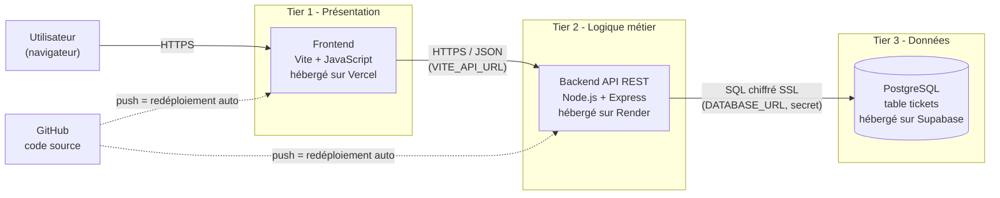

# Schéma d'architecture

Application de suivi des demandes informatiques, en architecture **trois tiers**.



Version texte :

```
                       HTTPS                    HTTPS / JSON                 SQL (SSL)
 Utilisateur  ───────────────────>  Frontend  ───────────────────>  Backend  ─────────────>  PostgreSQL
 (navigateur)                       (Vercel)                        (Render)                 (Supabase)
                                        ▲                               ▲
                                        └────────── GitHub ─────────────┘
                                          (push => redéploiement auto CI/CD)
```

## Rôle de chaque tier

| Tier | Composant | Rôle | Hébergement |
|------|-----------|------|-------------|
| Présentation | Frontend | Affiche les tickets, formulaire de création, changement de statut | Vercel |
| Logique métier | Backend (API) | Reçoit les requêtes HTTP, valide les données, accède à la base | Render |
| Données | PostgreSQL | Stocke les tickets de façon persistante | Supabase |
| Code source | Dépôt Git | Versionnement, déclenche les déploiements | GitHub |

## Sécurité

- Le frontend ne connaît que l'URL publique de l'API : **aucun identifiant de base de données** n'est présent côté navigateur.
- Seul le backend possède `DATABASE_URL` (variable d'environnement sur Render, jamais commitée).
- L'API n'accepte les appels navigateur que depuis l'URL du frontend (CORS, variable `CORS_ORIGIN`).
- Les données reçues sont validées par l'API, et les statuts sont aussi contrôlés par la base (`CHECK`).
- Requêtes SQL paramétrées (protection contre l'injection SQL).
- Row Level Security activé sur la table pour bloquer l'accès direct via l'API publique de Supabase.
